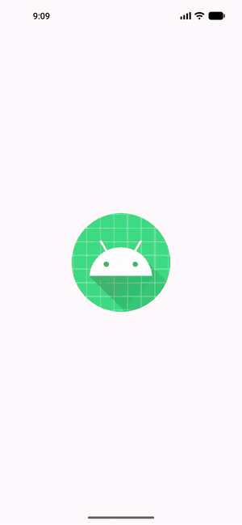

# AND101 Project 3 - AnimalApps

Submitted by: **Chigozie Okeke**

Time spent: **2** hours spent in total

## Summary

**AnimalApps** is an android app that recreates the Duolingo goal-setting page as **Duolingo for Elephants**, where learners pick a daily peanut goal.

If I had to describe this project in three (3) emojis, they would be: 🐘🥜📱

## Application Features

The following REQUIRED features are completed:

- [x] Pick an app screenshot to duplicate (Duolingo goal page)
- [x] Create a runnable app that displays an Animal Version of the chosen screenshot
- [x] Layout uses one (1) or more ConstraintLayout
- [x] Layout uses one (1) or more ImageView
- [x] Layout uses three (3) or more TextViews

## Video Demo

Here's a video / GIF that demos all of the app's implemented features:

GIF created with **ffmpeg**

## Notes

None.

## License

Copyright **2026** **Chigozie Okeke**

Licensed under the Apache License, Version 2.0 (the "License");
you may not use this file except in compliance with the License.
You may obtain a copy of the License at

    http://www.apache.org/licenses/LICENSE-2.0

Unless required by applicable law or agreed to in writing, software
distributed under the License is distributed on an "AS IS" BASIS,
WITHOUT WARRANTIES OR CONDITIONS OF ANY KIND, either express or implied.
See the License for the specific language governing permissions and
limitations under the License.
